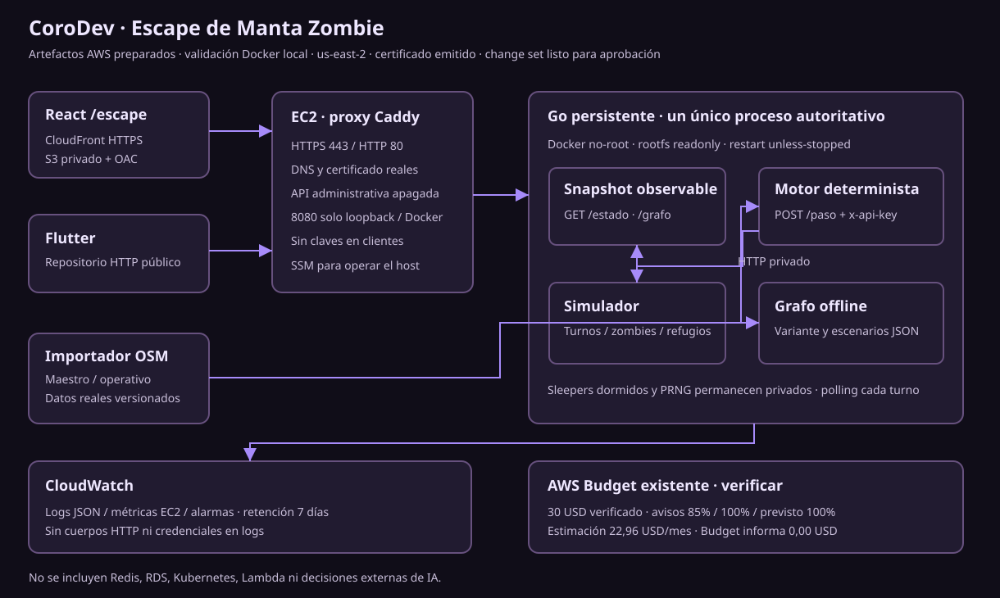
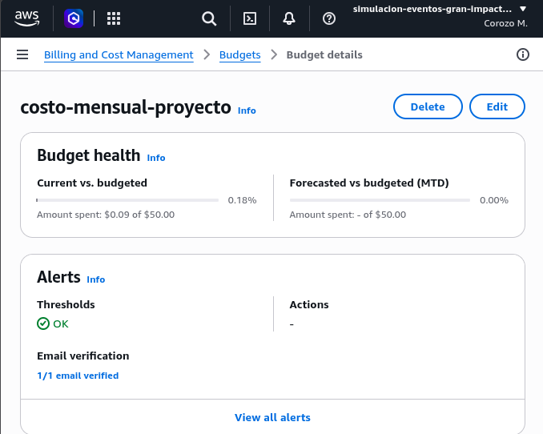

# MantaSim · CoroDev

**AWS Hackathon · Track A: Escape de Manta Zombie.**

Construí MantaSim para explorar cómo evacuar personas sobre una red vial real cuando las amenazas y los caminos disponibles cambian. El sistema combina un motor Go, una consola React y un cliente Flutter Android que observa las ejecuciones. Extendí la evacuación a un laboratorio de inundaciones urbanas con parámetros sintéticos.

## Demo pública

**[Abrir MantaSim](https://sistemamanta.lexinnovate.com/escape)** · [Inundaciones](https://sistemamanta.lexinnovate.com/flood-lab) · [Visor móvil](https://sistemamanta.lexinnovate.com/mobile) · [API](https://api.sistemamanta.lexinnovate.com/healthz)

Abre `/escape`, explora BASE y pulsa **Iniciar simulación**. Selecciona un sobreviviente para consultar su ruta, observa amenazas y refugios, y usa pausa o continuación. Abrir o recargar la página no crea otra ejecución. React `/mobile` y Android observan la última ejecución publicada; la consola de escritorio conserva el control.

La demo no solicita una clave de operador para iniciar simulaciones. Su versión, fecha de verificación y hashes están en [despliegue](docs/despliegue.md). La disponibilidad depende de la [retirada programada](deploy/autokill/README.md).

## Qué hace el sistema

- Calcula rutas sobre calles transitables y las revisa ante amenazas, cierres y falta de plazas.
- Ejecuta sesiones independientes con semilla, reloj, estado y credencial propios; ofrece pausa, continuación, cancelación y repetición.
- Muestra agentes, rutas y refugios a partir de observaciones del backend, con geografía descargada por separado.
- Permite comparar resultados reproducibles mediante HTTP real y consultar latencias, errores, CPU y memoria.

## Nivel Base

| Requisito | Implementación |
| --- | --- |
| Grafo de Manta | BASE: 300 intersecciones y 383 aristas derivadas de OSM; cuatro zonas de origen y cuatro refugios ficticios |
| Routing dinámico | Plan por snapshot, calles transitables, replanificación y espera cuando no existe una salida válida |
| Zombies | Caminantes, corredores, hordas y dormidos; mordidas por nodo y cruce, sin revelar dormidos ocultos |
| Obstáculos | Colapso de puente en R2 y dos cierres en R3; overlays sin modificar la geografía fuente |
| API | `POST /paso` autenticado por `x-api-key`, con respuesta de espera o vecino transitable |
| Visualización | Mapa React en vivo; Android y React móvil como espectadores |

La [matriz del reto](docs/pruebas.md#matriz-de-cumplimiento) distingue cumplimiento, alcance parcial y evidencia. BASE es una muestra urbana; FULL_MANTA, con 9.179 nodos, sigue siendo experimental.

## Nivel PRO

| Capacidad | Qué resuelve y evidencia |
| --- | --- |
| Predicción de corredores | Estima riesgo a partir de movimientos observados para anticipar desvíos; [predictor y límites](docs/nivel-pro.md#predicción-observaciones-y-horizonte) |
| Capacidad de refugios | Coordina ocupación, reservas y reasignación para evitar sobreasignaciones; [planificación](docs/nivel-pro.md#refugios-capacidad-reservas-y-concurrencia) |
| Cinco camionetas, cuatro plazas cada una | Recogen personas y las entregan en un refugio con capacidad; abordar todavía no cuenta como evacuación; [flota](docs/nivel-pro.md#rescate-selección-recorrido-y-supervivencia) |
| Velocidad doble: parcial | Hasta dos aristas reales por turno frente a una peatonal; no acredita doble velocidad física en m/s |
| Recogida y traslado | Prioriza necesidad y ahorro estimado, revalida calles/destinos y conserva pasajeros observables; [demo reproducible](docs/nivel-pro.md#demostración-reproducible) |

La flota es experimental y está excluida de `official`. Las mediciones incluyen regresiones: estas funciones no garantizan mayor supervivencia.

## Inundaciones y reportes ciudadanos

El laboratorio usa `rainfall_runoff_2d` o `compound_flood_2d`, con agua en una malla separada del grafo vial. Lluvia, relieve, costa, cauce y refugios son escenarios sintéticos. La geografía vial procede de OSM; la susceptibilidad SNGR y los eventos históricos conservan fuente y fecha, como contexto independiente del cálculo hidráulico.

Los reportes ciudadanos se reciben mediante una API real y se guardan en disco privado. Nacen pendientes y no cambian automáticamente una tormenta. Esta extensión **no es un sistema oficial de alerta ni una recomendación de evacuación**. [Laboratorio](docs/laboratorio-inundaciones.md) · [fuentes](docs/datos-oficiales-y-demo.md) · [reportes](docs/incidentes-ciudadanos.md).

## Inicio rápido

Requisitos: Node ≥22.12, npm ≥10, Go ≥1.23, Python 3 y GNU Make. Flutter y Docker son opcionales para ejecutar la web local.

```sh
make setup
make dev
```

Abre **http://127.0.0.1:5173/escape** y pulsa **Iniciar simulación**. El laboratorio está en `/flood-lab` y el espectador en `/mobile`. El arranque local utiliza Go en los puertos 8080/8082, sin AWS.

`setup` instala dependencias, genera contratos/tokens y crea configuración privada sólo cuando falta. **Ctrl+C** o `make stop` detienen los procesos sin borrar reportes. Consulta `make help` y la [guía local](docs/despliegue.md#desarrollo-local) para puertos, configuración y recuperación. [Android opcional](apps/mobile/README.md).

## Arquitectura y AWS



Organicé el backend como un monolito modular Go: sólo el simulador modifica el mundo y las decisiones leen snapshots inmutables. Cada sesión aísla RNG, cachés y HTTP autenticado; los clientes usan polling. El laboratorio y su almacenamiento ciudadano permanecen independientes.

El despliegue documentado usa **EC2 `m7i-flex.large`, 2 vCPU/8 GiB, Ohio (`us-east-2`)**, con Docker y Caddy para HTTPS. React se sirve desde S3 privado mediante CloudFront/OAC y ACM. SSM permite operar sin SSH público; CloudWatch recibe logs y métricas. Cloudflare DNS y Let's Encrypt son externos a AWS. [Arquitectura y decisiones](docs/arquitectura.md) · [fuente del diagrama](docs/arquitectura.mmd) · [despliegue y recuperación](docs/despliegue.md).

## API y prueba de fuego

`POST /paso` requiere `Content-Type: application/json` y cabecera privada `x-api-key`:

```json
{"sobrevivienteId":"S-0089","nodoActual":"N-0117","turno":142}
```

```json
{"siguienteNodo":"N-0118"}
```

Los IDs son ilustrativos: usa el nodo y turno reales del mismo runtime. `/paso` sólo consulta el siguiente movimiento. `/estado` y `/paso` públicos conservan un runtime preparado e inactivo; cada sesión de React consulta su propio HTTP loopback. No hay WebSocket implementado. [Ejemplo curl, autenticación y ámbitos](docs/contratos.md).

Después de preparar el entorno, reproduce las tres rondas nominales, secuencialmente, desde la raíz:

```sh
npm run simulate -- -scenario scenarios/urban/round1.json -interval 2s -output reports/realtime/r1.json
npm run simulate -- -scenario scenarios/urban/round2.json -interval 2s -output reports/realtime/r2.json
npm run simulate -- -scenario scenarios/urban/round3.json -interval 2s -output reports/realtime/r3.json
```

R1/R2/R3 usan **20/80/200 sobrevivientes**, **150 turnos de dos segundos**, cinco minutos nominales por ronda. La CLI utiliza HTTP real autenticado en un proceso local aislado. [Pruebas](docs/pruebas.md) define supervivencia, eficiencia, p95, disponibilidad, rúbrica y benchmarks; el evaluador FASE 1 permanece congelado. No se promedian p95 para obtener un percentil conjunto.

## Resultados verificables

La consolidación del 27 de octubre registró **16 rondas aceleradas completas, 2.400 turnos y 93.962 solicitudes válidas**, sin inválidas/timeouts y con hashes lógicos repetidos. Son mediciones locales anteriores a la instrumentación CloudWatch y a esta limpieza; no certifican capacidad EC2 ni sustituyen los quince minutos nominales.

En R3 con semilla 42, `legacy_current` sin flota registró 169 evacuados, un mordido y 30 activos; la variante temporal tuvo más mordidos. La flota también redujo evacuados frente a sus pares sin flota. Conservo esos resultados junto con las condiciones de medición en [pruebas](docs/pruebas.md#mediciones-locales-de-esta-consolidación). Allí se separan las suites ejecutadas, benchmarks y comprobaciones de despliegue.

## Costos, Budget y limitaciones

La proyección documentada es **78,28 USD/mes**, con 730 horas y supuestos de uso pequeño, antes de descuentos. El Budget verificado es de **50 USD/mes** y no detiene cargos. [Cálculo, tarifas y exclusiones](docs/costos.md).

**Pendientes:** gasto real atribuible al evento, captura auténtica de AWS Budget y presentación PDF/PPT/PPTX ≤20 MB. La captura revisada debe incorporarse como `docs/budget.png`; no incluyo una imagen ficticia. [Lista de entrega](docs/limitaciones.md).



Las sesiones se pierden al reiniciar Go; los reportes tienen persistencia independiente. Predicción sin calibrar, cinemática por aristas, FULL experimental, hidráulica sintética y validación pendiente en dispositivos físicos limitan el alcance. [Limitaciones completas](docs/limitaciones.md).

## Documentación y estructura

| Tema | Entrada |
| --- | --- |
| Componentes, flujo y decisiones | [Arquitectura](docs/arquitectura.md) |
| Desarrollo local, Docker, AWS y CloudWatch | [Despliegue](docs/despliegue.md) |
| Requisitos Base/PRO, reproducción y resultados | [Pruebas](docs/pruebas.md) · [Nivel PRO](docs/nivel-pro.md) |
| Contratos HTTP y generación TS/Dart/JSON Schema | [Contratos](docs/contratos.md) · [OpenAPI](packages/contracts/openapi.yaml) |
| Costos y entregables pendientes | [Costos](docs/costos.md) · [Limitaciones](docs/limitaciones.md) |
| Geografía, hidráulica e informes conservados | [Referencias técnicas](docs/INDEX.md) |
| Modificar el repositorio | [AGENTS.md](AGENTS.md) |

El código vive en `services/evacuation` (Go), `apps/web` (React) y `apps/mobile` (Flutter). `packages` conserva contratos, diseño y recursos visuales compartidos; `tools` y `deploy` reúnen desarrollo, medición y artefactos AWS.

## Autoría

Soy [corozodev](https://github.com/corozodev), único integrante de **CoroDev**. Desarrollé MantaSim con apoyo de asistentes de IA para implementación, revisión y documentación. El [repositorio público](https://github.com/corozodev/simluacion-desastres-manta) conserva la evolución del proyecto. Agradezco las fuentes de OpenStreetMap, GeoManta y SNGR/CONAGE; su [procedencia y atribución](docs/datos-oficiales-y-demo.md) permanecen explícitas.
