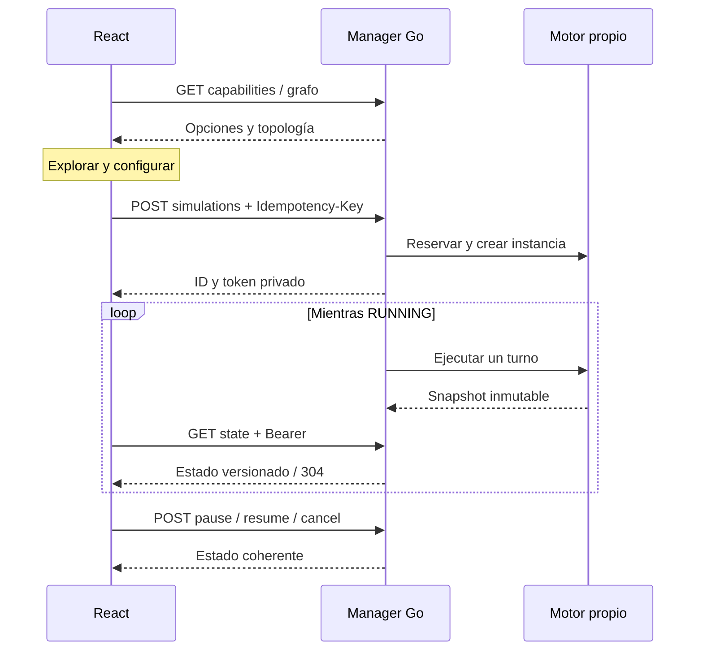

# Flujo de datos

1. React `/escape` consulta capacidades y el grafo estático. No crea una ejecución al montar, navegar o recargar.
2. Al pulsar **Iniciar simulación**, envía configuración validada y una clave de idempotencia a `POST /v1/simulations`.
3. Go valida escenario, grafo, refugios y parámetros; reserva cupos antes de crear un motor con estado propio.
4. La respuesta devuelve `simulation_id` y un token opaco. React conserva la credencial en `sessionStorage`, vinculada a la API, y la envía únicamente por `Authorization: Bearer`.
5. El manager avanza los turnos. El motor publica el estado de decisión, consulta `/paso` por HTTP loopback autenticado y aplica los movimientos en orden estable. El navegador no impulsa turnos.
6. React observa `/{id}/state` aproximadamente cada dos segundos con solicitudes no acumulativas. La topología se reutiliza; el estado lleva versión, métricas y entidades observables.
7. Pausar, reanudar y cancelar cambian la máquina de estados. Reiniciar crea un nuevo ID con la misma configuración y semilla, sujeto a los mismos límites.
8. Al terminar se conserva el resultado hasta su TTL. Una recarga consulta la misma sesión; 404/410 limpia la credencial obsoleta y permite un nuevo inicio explícito.

`/estado`, `/grafo`, `/healthz` y `/paso` conservan compatibilidad, pero el runtime legacy no se inicia por defecto y no representa las sesiones privadas. Los reportes Flutter, referencias oficiales y overlays del laboratorio se mantienen separados. No se copian reportes posteriores a una simulación histórica ni se presentan índices sintéticos como observaciones reales.
