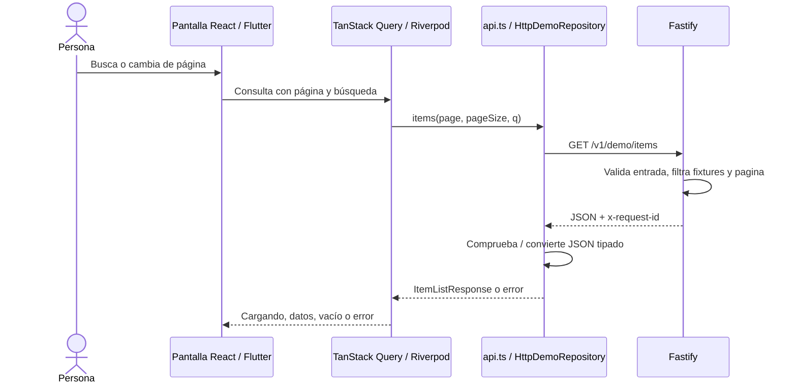

# Flujo de datos

## Lectura de registros

El servidor busca en título y descripción sin distinguir mayúsculas, calcula `pagination.total` sobre el resultado filtrado y luego pagina. `page` comienza en 1. Los clientes piden normalmente seis registros; el valor predeterminado del contrato es diez. Una búsqueda sin coincidencias y una página fuera de rango devuelven `data: []`, no un error.

La web utiliza claves de consulta con página y búsqueda y desactiva reintentos automáticos. Flutter usa una familia de proveedores con página y búsqueda, también sin reintentos automáticos. El botón de reintento inicia una nueva consulta de forma explícita.

## Formulario

La pantalla valida título obligatorio y límites de longitud. Mientras existe una petición activa desactiva el envío. El repositorio manda `POST /v1/demo/submit` con JSON; Fastify valida el cuerpo y responde `202` con `submissionId`, `status: accepted` y mensaje. La confirmación se muestra en la pantalla. No se agrega un fixture, no se almacena una colección de envíos y no existe una consulta posterior de ese envío. Esta prevención de doble clic no constituye idempotencia del servidor.

## Errores y cancelación

| Origen | Resultado |
| --- | --- |
| Entrada inválida | HTTP 400, `VALIDATION_ERROR`, `details` por campo cuando están disponibles |
| Registro o ruta inexistente | HTTP 404, `NOT_FOUND` |
| Error interno | HTTP 500, `INTERNAL_ERROR`, sin stack privado en la respuesta |
| API apagada o red inaccesible | Error del cliente `BACKEND_UNAVAILABLE` |
| Tiempo agotado | Error del cliente `TIMEOUT` |
| Respuesta no interpretable | Error del cliente `INVALID_RESPONSE` |

La web usa `AbortController` y un temporizador configurable; la cancelación de una consulta no se presenta como timeout. Dio configura tiempos de conexión, envío y recepción. El request ID, cuando existe, permite buscar el error en los registros. Las simulaciones por encabezados requieren desarrollo explícitamente habilitado; véase [pruebas](../development/testing.md).

## Configuración e identidad

Vite lee las variables `VITE_API_*` al iniciar o compilar. Flutter recibe `API_*` mediante `--dart-define` al ejecutar o compilar. Cambiar esos valores requiere reiniciar o recompilar el cliente. El modo no cambia el transporte: ambos usan HTTP.

Los tokens y la marca se leen durante la generación, no con una petición de red en la app. React importa los derivados CSS/TS y Flutter importa `tokens.g.dart` y `brand.g.dart`. La generación y su comprobación están descritas en [design system](../design/design-system.md).
