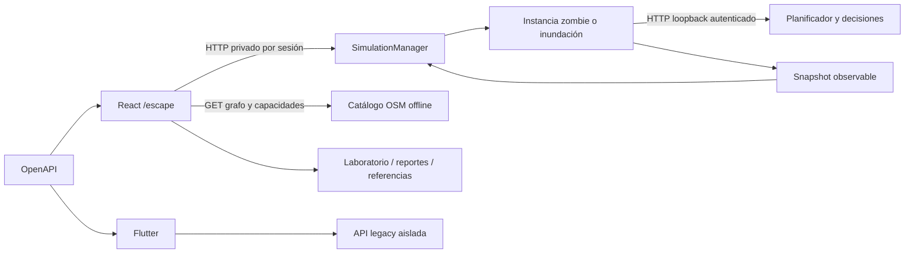

# Arquitectura

CoroDev mantiene un monolito modular Go con React y Flutter. OpenAPI 3.0.3 genera modelos TypeScript, Dart y JSON Schema; los tokens y la identidad visual también se generan desde sus fuentes compartidas.

| Módulo | Responsabilidad |
| --- | --- |
| `apps/web/src/services/api.ts` | Transporte HTTP y validación de respuestas; credenciales sólo por cabecera |
| `apps/web/src/services` | Caché de consultas, controles y recuperación de sesión |
| `apps/mobile/lib/core` | Repositorios Go y reportes ciudadanos; sin cambios de flujo en FASE 5 |
| `services/evacuation/internal/sessions` | Autorización, idempotencia, capacidad, tiempo, lifecycle y resultados |
| `internal/simulation`, `decision`, `coordination` | Motor determinista, amenazas y planificación observable |
| `internal/catalog`, `graph`, `world` | Geografía offline, índices y snapshots seguros |
| `internal/control` | Compatibilidad con rondas legacy y administración independiente |
| `internal/floodlab`, `incidents`, `reference` | Laboratorio y procedencia externa separados de las sesiones públicas |
| `packages/contracts`, `packages/design-tokens` | Fuentes de verdad de contratos y presentación |

El proceso arranca sin ejecutar turnos. La creación explícita reserva recursos antes de construir una instancia; dos sesiones no comparten posiciones, RNG, ocupación ni overlays. BASE es el perfil operativo de 300 nodos y FULL_MANTA el maestro experimental de 9.179, habilitado de forma explícita. La topología estática se consulta por separado.

El manager vive en una sola instancia y conserva un número acotado de snapshots en RAM. El reinicio del proceso pierde las sesiones, sin recrearlas automáticamente. Los reportes ciudadanos del laboratorio conservan su persistencia y procedencia propias. La infraestructura existente de EC2/Docker/Caddy y S3/CloudFront no requiere nuevos servicios para esta fase.

Los detalles operativos y resultados de validación están en [FASE 5](../informe-fase5.md). Las decisiones históricas permanecen en `docs/decisions` y los informes de fases previas.
