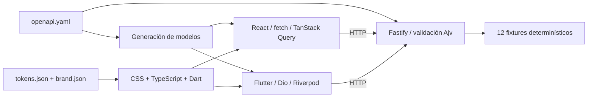

# Arquitectura

El starter tiene dos clientes independientes y un servidor local. Comparte el contrato y la identidad; no comparte componentes de interfaz entre React y Flutter. Los registros son ejemplos genéricos sin reglas de negocio.

## Límites por directorio

| Módulo | Implementación | Punto de extensión |
| --- | --- | --- |
| `apps/web/src/services` | Adaptador `api.ts` y consultas `queries.ts` | Cambiar transporte o consultas sin incrustar fixtures en componentes |
| `apps/mobile/lib/core/api` | `DemoRepository`, `HttpDemoRepository` y configuración Dio | Inyectar otra implementación mediante `repositoryProvider` |
| `services/mock-api/src` | Rutas Fastify, lectura del contrato, fixtures y error handler | Mantener entradas y salidas alineadas con OpenAPI |
| `packages/contracts` | OpenAPI 3.0.3, ejemplos y tipos TS generados | Agregar operaciones y regenerar ambos clientes |
| `packages/design-tokens` | Tokens y marca JSON | Cambiar identidad en origen y regenerar |

React mantiene consultas y mutaciones con TanStack Query; Flutter expone repositorio y consultas con Riverpod. La navegación usa React Router y GoRouter respectivamente: `/`, `/items`, `/items/:id`, `/demo` y `/diagnostics`. La web usa sidebar adaptable y Flutter navegación inferior.

## Contrato y errores

Fastify obtiene esquemas del YAML y valida solicitudes y respuestas. Genera un request ID por petición y lo expone en `x-request-id`; los errores incluyen el mismo identificador en el sobre. Las respuestas exitosas se validan antes de serializar para detectar datos que incumplen el contrato.

Los tipos de TypeScript no validan JSON durante ejecución. El adaptador web comprueba la forma de las respuestas; los modelos Dart realizan parsing tipado. Ninguno de esos mecanismos sustituye todas las reglas de validación del servidor. Los adaptadores traducen fallos de red y timeout a errores comprensibles para la presentación.

## Sustitución del backend

`mock` y `remote` describen el modo activo; ambos hacen HTTP. No existe un repositorio de fixtures oculto en producción. Cambiar la URL permite consumir una API compatible, conservando un posible prefijo de stage. La configuración es pública: nunca contiene secretos.

La arquitectura futura puede ser clientes → API Gateway → Lambda → servicios exigidos por el assignment. Aún no hay funciones Lambda, autenticación, base de datos ni infraestructura como código. La [guía AWS](../aws/integration.md) documenta los pasos sin desplegar recursos.

## Decisiones y límites

El monorepo reduce la coordinación de cambios entre contrato, API y clientes. npm administra los módulos JavaScript; Flutter conserva `pubspec.yaml` y su lockfile. No se introduce un framework de monorepo adicional. Las decisiones están en [ADR-001](../decisions/ADR-001-monorepo.md), [ADR-002](../decisions/ADR-002-contract-first.md) y [ADR-003](../decisions/ADR-003-mock-api.md).

El mock confirma formularios sin persistencia. Sus IDs y fechas fijos hacen repetibles las pruebas de lectura; los request IDs son propios de cada solicitud. Android es la plataforma móvil configurada; el código usa bibliotecas multiplataforma, pero eso no equivale a haber validado iOS.
