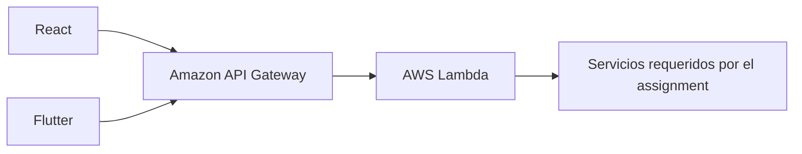

# Integración futura con AWS

Esta guía prepara una sustitución del mock; no describe infraestructura desplegada. No existen recursos, credenciales, Lambdas ni plantillas de despliegue AWS en esta entrega. Los servicios adicionales dependen del assignment.



## Mantener el contrato y cambiar la URL

Implementa en el backend las cuatro operaciones de `packages/contracts/openapi.yaml`, incluidos códigos HTTP, tipos y sobre de errores. Conserva `x-request-id`. Si cambia el contrato, regenera y valida ambos clientes antes de sustituir el mock.

Para una HTTP API con stage `dev`, usa como base, por ejemplo:

```text
https://<api-id>.execute-api.<region>.amazonaws.com/dev
```

Con stage por defecto o dominio propio, usa la URL efectiva de ese despliegue. No agregues `/v1/demo/items` a la base: cada adaptador añade la ruta de operación. Los adaptadores conservan el prefijo del stage, de modo que la base `/dev` produce `/dev/health` y `/dev/v1/demo/items`.

En `apps/web/.env.local`, antes de iniciar Vite o compilar:

```dotenv
VITE_API_MODE=remote
VITE_API_BASE_URL=https://<api-id>.execute-api.<region>.amazonaws.com/dev
VITE_API_TIMEOUT_MS=8000
```

Para Flutter, desde `apps/mobile`:

```sh
flutter run \
  --dart-define=API_MODE=remote \
  --dart-define=API_BASE_URL='https://<api-id>.execute-api.<region>.amazonaws.com/dev' \
  --dart-define=API_TIMEOUT_MS=10000
```

Sustituye todos los placeholders antes de ejecutar. Los valores son públicos y se incorporan al cliente. Reinicia o recompila tras cambiarlos. `remote` no implementa autenticación automáticamente.

## CORS para la web

En la HTTP API configura orígenes exactos de desarrollo y del frontend publicado; métodos `GET`, `POST`, `OPTIONS`; encabezado permitido `content-type`; y encabezado expuesto `x-request-id`. Habilita `authorization` únicamente si implementas un flujo que lo envíe. No traslades los encabezados artificiales `x-demo-*` al backend remoto.

Cuando CORS está configurado en una HTTP API, API Gateway gestiona preflight y aplica esa configuración; ignora los encabezados CORS de la integración. Mantén una sola configuración coherente y revisa el comportamiento de `OPTIONS` si agregas un authorizer a la ruta por defecto. [Documentación oficial de CORS para HTTP APIs](https://docs.aws.amazon.com/apigateway/latest/developerguide/http-api-cors.html).

Flutter nativo no está sujeto a CORS del navegador; sigue necesitando una API accesible y autorización cuando el producto la requiera. No interpretes CORS como control de acceso al backend.

## Autenticación, IAM y secretos

La demo local no autentica usuarios. Si el reto exige identidad, define quién accede a qué y elige un flujo de tokens compatible con web y móvil; después implementa validación en API Gateway/backend y gestión de sesión en los clientes. Documenta los nuevos errores y pruebas. No agregues un servicio de identidad antes de conocer esa necesidad.

Para workloads usa roles con permisos mínimos sobre recursos concretos; separa permisos de despliegue y ejecución. Para operadores y automatización prefiere credenciales temporales. No incluyas access keys en Vite, Dart, fixtures o logs. Estas decisiones siguen las [prácticas oficiales de IAM](https://docs.aws.amazon.com/IAM/latest/UserGuide/best-practices.html).

Si aparece un secreto de backend, guárdalo en un mecanismo gestionado adecuado a sus requisitos y entrega permiso de lectura solo al rol que lo necesita. Una URL pública de API no es un secreto; una contraseña o clave privada sí. No se ha elegido ni aprovisionado un servicio de secretos en esta fase.

## Logs y diagnóstico

Propaga un request ID estable en `x-request-id` y en `error.requestId`; registra el ID de ejecución de Lambda como dato de correlación cuando corresponda. Usa logs estructurados con ruta, estado y duración, evitando cuerpos y tokens. Configura permisos y retención explícitos para los grupos de logs.

Lambda puede enviar logs a CloudWatch Logs con los permisos de ejecución correspondientes; el destino y los niveles se configuran en el despliegue. No presupongas que un log de cliente basta para diagnosticar la función. [Documentación oficial de logs Lambda](https://docs.aws.amazon.com/lambda/latest/dg/monitoring-logs.html).

## Despliegue reproducible cuando haya alcance

Elige una sola herramienta de infraestructura como código, por ejemplo SAM o CDK, según lo que requiera el equipo. Añade únicamente API, funciones, permisos y recursos que use el flujo mínimo. Parametriza región, stage y orígenes, exporta la URL efectiva y documenta comandos de despliegue y retirada. Ejecuta validación del contrato, pruebas, builds y una verificación HTTP del entorno antes de promover la URL a los clientes.

La implementación actual del mock Fastify no es un handler Lambda listo para desplegar. Será necesario implementar/adaptar la integración y empaquetar sus dependencias. No copies solo `dist`: el mock local lee el YAML en ejecución.

## Límites y costes

Antes de activar recursos, estima tráfico, invocaciones, duración/memoria de Lambda, transferencia y volumen/retención de logs para la región y cuenta reales. Revisa límites de concurrencia y timeout, configura presupuesto/alertas y un procedimiento de retirada. No se asume gratuidad ni se dan precios estimados sin esos datos. Tampoco se asume que DynamoDB, S3, Bedrock u otro servicio sea necesario.

La comprobación local no garantiza equivalencia de límites, autenticación o latencia en AWS. Después del despliegue, repite navegación, búsqueda, formulario, errores y diagnóstico de ambos clientes con HTTPS y la URL final.
