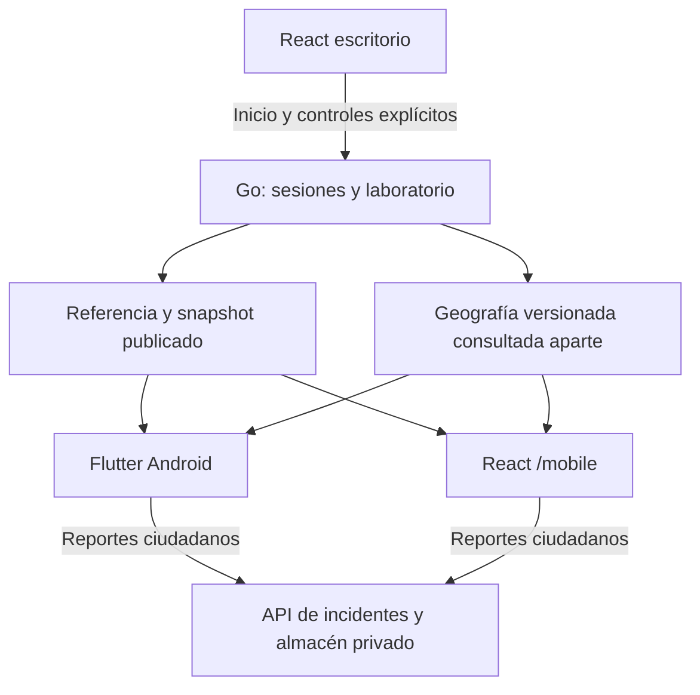

# FASE 7 móvil — MantaSim compartido

Implementación local del 27 de octubre de 2026 (Ecuador). Esta iteración amplía los clientes y la publicación; conserva el motor, los grafos, el evaluador FASE 1 y los informes anteriores. No hace push, cambia DNS ni despliega en AWS.

## Resultado y auditoría

React escritorio controla las ejecuciones de `/escape` y `/flood-lab`. Flutter Android y React `/mobile` sólo observan y permiten reportar novedades ciudadanas. Un espectador nuevo obtiene directamente el turno actual; su llegada no crea agentes, motores ni sesiones privadas.

La auditoría encontró dos runtimes ya implementados:

| Runtime | Identidad y estado | Transporte anterior | Publicación móvil |
| --- | --- | --- | --- |
| `internal/sessions` | ID aleatorio; metadatos/snapshot por ejecución; escritor, RNG y overlays propios; controles con token opaco | Polling de `/v1/simulations/{id}/state` | Última creación válida por escenario, con referencia al mismo `execution`; GET anónimo |
| `internal/floodlab` | `run_id`, escenario, refugios y reloj compartidos; transición/turno serializados | Polling de `/lab/state`, con timeline y comparación | Mismo run mediante `/lab/published`, sin timeline acumulado ni comparación |

No se unificaron los motores ni se volvió a implementar la evacuación en Dart/TypeScript. La tormenta de `/flood-lab` se consulta en `/lab/published`; una sesión `urban_flood` creada explícitamente en `/v1/simulations` pertenece a ese otro runtime y mantiene su publicación independiente.



## Publicación y sincronización

`GET /v1/simulations/published/{scenario}` devuelve `{scenario, availability, simulation?}`. `none` indica ausencia de publicación; `unavailable`, caducidad/cierre; `available` incluye metadatos y snapshot actual. Los estados `CREATED`, `RUNNING`, `PAUSED`, `COMPLETED`, `CANCELLED` y `FAILED` se presentan en español. Los finales incluyen resultados y siguen disponibles durante la retención existente. La última creación correcta reemplaza la referencia de su escenario; un replay idempotente antiguo no vuelve a publicar la ejecución anterior.

Los espectadores no reciben tokens ni renuevan la caducidad. Un controlador que abandone su sesión puede perderla por los TTL normales aunque haya espectadores. No existe persistencia de sesiones tras reiniciar Go. El laboratorio conserva su último estado hasta una nueva transición explícita; `idle` se presenta sin simulación publicada.

Ambos endpoints públicos cachean JSON y ETag por versión. Un estado sin cambios responde 304. No incluyen nodos, aristas ni geometrías del grafo. Los clientes cachean la topología por perfil/versión; para inundaciones comprueban también la ejecución y la geografía efectiva de sus candidatos. El cambio de ID limpia selecciones y rutas. Nunca se representan entidades sobre otra versión de geografía.

El polling activo es de dos segundos, con consultas seriales; los errores usan espera progresiva hasta 30 segundos. Los terminales y la ausencia de ejecución usan descubrimiento lento (15 segundos), para encontrar la siguiente publicación sin descargar turnos pasados. La recarga y reconexión recuperan directamente un snapshot actual. Flutter suspende observación y rendering al pasar a segundo plano; React suspende polling al ocultarse. React detecta también `online/offline` explícitamente: TanStack puede pausar una consulta sin producir un error y eso no debe dejar el mapa antiguo marcado como actualizado.

Las cuotas de espectadores de sesiones están separadas de controles: hasta `50 × SIM_RATE_LIMIT_PER_MINUTE` por IP directa/minuto (6.000 por defecto), con 1.024 buckets acotados. No se confía en `X-Forwarded-For`. La caché evita multiplicar el trabajo de simulación; transmisión y rendering sí crecen con espectadores.

## Flutter Android

Navegación inferior con **Brote zombi** violeta e **Inundaciones** cian. El mapa conserva su cámara por escenario; no hay configuración, inicio, pausa ni cancelación. El HUD muestra turno/estado y métricas compactas. Personas y refugios se inspeccionan en bottom sheets; «Ver ruta» resalta la secuencia publicada y conserva geometrías OSM reales, sin calcular otra ruta local.

El renderer Canvas conserva zoom, desplazamiento, restablecimiento y capas; figuras humanas y amenazas se diferencian por forma y color. Se evitan animaciones decorativas y listas técnicas. Los refugios son ficticios/propuestos, no instalaciones oficialmente habilitadas.

Dentro de inundaciones se alternan **Mapa ciudadano** y **Simulación experimental**. La primera muestra OSM, refugios propuestos, novedades y referencia histórica SNGR disponible. La segunda presenta agentes, rutas, refugios, exposición y estado de vías sintéticos, con aviso explícito. Los cierres de una tormenta no aparecen como incidencias reales.

El formulario ciudadano existente permite ubicación manual o GPS opcional, tipo admitido, descripción, transitabilidad/severidad declaradas, revisión y confirmación. Resuelve la ubicación con la API real, conserva límites y reintentos idempotentes, y no presenta una recepción ficticia. Los reportes nacen `pending`; su creación no modifica el grafo operativo. La referencia oficial es visual y versionada, sin convertir exposición sintética en pronóstico.

## Visor React móvil

`/mobile` abre directamente fuera del `AppShell` administrativo, mediante carga diferida. Reutiliza adaptador HTTP, contratos, geometría, capas y visualización, y no importa las pantallas administrativas. En ancho móvil ocupa la pantalla, respeta safe areas y ofrece objetivos táctiles. En escritorio usa un contenedor con marco estilizado de teléfono; la interfaz interior es React vivo, sin iframe ni capturas simuladas.

Incluye los mismos escenarios, separación ciudadano/sintético, rutas publicadas, inspección de refugios, estado vacío y avisos de conexión. El reporte web resuelve calles reales; las coincidencias ambiguas se presentan con nombres sencillos. Cuerpo, `event_time`, calle y `Idempotency-Key` se congelan para reintentar exactamente el mismo envío. No se almacenan credenciales administrativas ni de `/paso`.

La consola ofrece enlace a `/mobile`; el botón Android sólo aparece si `VITE_ANDROID_APK_URL` contiene una URL HTTPS válida y real. No se inventa una URL de descarga. El visor ciudadano no exige visitar la consola.

## Inundaciones sin operador

Se retiraron el formulario, los campos de operador/código y la dependencia de sesión/CSRF del ciclo de tormentas. Abrir `/flood-lab`, configurar e iniciar funciona directamente, sin pasar por `/escape` ni recibir una contraseña automática.

El backend permite anónimamente las mismas operaciones de negocio: `/lab/runs`, `/lab/actions`, `/lab/candidates/validate` y `/lab/comparisons`. Conserva validación JSON estricta, límites, Origin/Host, exclusión mutua y `expected_run_id`. Un inicio concurrente con el ID anterior tiene un solo ganador; el otro recibe 409. Añade límites de 120 controles y 10 inicios/comparaciones por IP/minuto. No se creó un endpoint alternativo que eluda validaciones.

Moderación/aplicación de incidentes y actualización de referencias siguen protegidas. Abrir esas herramientas puede consultar su sesión opcional; esa sesión no bloquea ni condiciona una tormenta.

## Contrato e integración AWS preparada

| Endpoint | Cambio |
| --- | --- |
| `GET /v1/simulations/published/{scenario}` | Nuevo snapshot público de sesiones; ETag/304; sin token/topología ni renovación de lease |
| `GET /lab/published` | Nuevo snapshot compacto del run del laboratorio; ETag/304 |
| `GET /lab/graph` | Geografía aparte, coherencia de run/versión y ETag |
| `POST /lab/runs`, `/lab/actions`, `/lab/candidates/validate`, `/lab/comparisons` | Sin credenciales de operador; conserva reglas y añade límites de solicitudes |
| `/v1/incidents*`, `/v1/reference/*` | Reutilizados; sin nuevos tipos de novedad ni almacenamiento |

OpenAPI es la fuente de verdad; TypeScript y JSON Schema se regeneraron. Dart normaliza los snapshots de transporte en modelos de presentación y reutiliza `WorldSnapshot`, `Graph`, refugios y reportes generados; no modifica archivos generados manualmente ni introduce algoritmos de decisión.

El `cmd/server` existente ya enruta `/v1/simulations/*` y puede proxyar laboratorio/ciudadanía/referencia mediante `FLOOD_LAB_UPSTREAM=http://127.0.0.1:8082`. El laboratorio sigue escuchando loopback y el proxy reescribe Host. Así Flutter y web pueden usar el mismo origen HTTPS de API, manteniendo el almacén ciudadano privado independiente. La configuración local de tres procesos conserva también URLs separadas.

No se hicieron llamadas AWS, push, reinicios remotos ni cambios DNS. Los artefactos locales preparados requieren una publicación posterior autorizada; la API ya desplegada puede seguir ejecutando la versión anterior. La ausencia de login y la separación de URLs no son mecanismos de autenticación para otras operaciones.

## Verificación

| Verificación ejecutada | Resultado |
| --- | --- |
| `npm install` | Correcto; resoluciones existentes, 0 vulnerabilidades notificadas |
| `contracts:validate`, `contracts:generate`, `tokens:generate`, `generated:check`, `check` | Correctos; tipos estrictos, ESLint y fuentes generadas sincronizadas |
| `npm test` | 160 pruebas web y 40 del servicio de demostración conservado, aprobadas |
| `test:backend`, `test:race`, `build:backend`, `go vet ./...` | Correctos; incluye sesiones e inundaciones con detector de carreras |
| `graph:test` | 10 pruebas aprobadas |
| `test:contracts:http` | Go real, `/paso` autenticado y sobre de errores correctos |
| `test:contracts:simulations` | 657 aserciones correctas |
| `test:contracts:flood` | Escenario completo, overlay, estado compacto y contrato correctos |
| `test:lab:flood -- --api-only` | Validaciones, pausa y comparación reales correctas |
| `test:spectators:http -- --flutter` | Contratos, ciclo de vida, lecturas 1/10/50 y dos integraciones Dart reales aprobados |
| `test:spectators:browser -- --flutter` | React escritorio inicia; React móvil y el repositorio Dart observan exactamente los mismos IDs y el mismo paso pausado. Rutas, refugios, desconexión/reconexión y reporte ciudadano recibido correctos |
| `test:e2e` | 12 pruebas Chromium desktop/móvil aprobadas, con contratos interceptados |
| `test:incidents:e2e` | Dart y Go reales, persistencia tras reinicio, consulta React, aplicación experimental protegida, idempotencia y regresión correctos |
| `test:references:e2e` | 10 comprobaciones aprobadas: 59 polígonos / 3.463 vértices, BASE/FULL, referencia histórica y simulación híbrida, sin tráfico a proveedores |
| `mobile:check`, `mobile:test`, `mobile:build` | Sin incidencias; 29 pruebas aprobadas, 3 integraciones opt-in omitidas en suite general; APK debug compilado |
| Integraciones Dart opt-in ejecutadas aparte | Publicados y reporte ciudadano: 2 aprobadas contra Go real; lectura, creación, replay y consulta |
| `build:web` | Build de producción correcto; módulos administrativos separados del visor |

Las pruebas detectaron y corrigieron tres problemas reales de integración: aviso de desconexión omitido cuando TanStack pausaba solicitudes; panel de selección de reporte que tapaba las calles; y selección ambigua de calle bloqueada por interpretar incorrectamente `matched=false, ambiguous=true`. El último caso ahora usa el contrato real y valida la calle elegida al enviar.

`TestPublishedHTTPLateJoinAtTurn80DoesNotReplay` avanzó el motor real hasta el turno 80 usando un reloj de planificación acelerado y decisiones por HTTP autenticado. Un GET nuevo devolvió directamente turno 80/150, sin modificar el total de turnos, sesiones o motores. Pasó junto con todo el paquete de sesiones bajo `-race`. La prueba simultánea React/Dart conserva la observación comparada en `deploy/evidence-private/mobile-spectators/flutter-shared-with-react.json`.

## Mediciones locales

Se probaron 80 agentes sobre BASE, con tres oleadas de solicitudes separadas por dos segundos para cada número de espectadores. Ambos motores avanzaron durante la medición; cada grupo observó un único ID, sin errores. CPU es una aproximación desde `/proc`, porcentual respecto a un núcleo; RSS corresponde al proceso, no a una instancia AWS. Latencia incluye transporte loopback y contención del generador local; no es latencia de Internet ni un límite garantizado. Son muestras cortas, sin prueba de carga sostenida.

| Escenario | Espectadores | Solicitudes/s | p95 local (ms) | Payload medio (bytes) | RSS (KiB) | CPU de proceso (%) | Errores |
| --- | ---: | ---: | ---: | ---: | ---: | ---: | ---: |
| Zombis | 1 | 0,50 | 4,78 | 51.810 | 53.212 | 4,50 | 0 |
| Zombis | 10 | 5,00 | 11,74 | 46.870 | 54.008 | 5,00 | 0 |
| Zombis | 50 | 24,99 | 77,43 | 42.473 | 54.356 | 4,17 | 0 |
| Inundación | 1 | 0,50 | 2,66 | 63.939 | 40.032 | 5,33 | 0 |
| Inundación | 10 | 5,00 | 21,68 | 63.128 | 40.044 | 5,50 | 0 |
| Inundación | 50 | 24,99 | 127,92 | 65.868 | 40.124 | 4,17 | 0 |

Los turnos observados fueron 2–5, 7–11 y 13–17 en las oleadas de 1/10/50. Los tests deterministas con reloj controlado comprobaron además que 50 lectores no cambian sesiones, turnos ni trabajo del motor. No se concluye ausencia de impacto temporal sólo a partir de esas observaciones. ETag/304 se comprobó con estado detenido; las oleadas activas recibieron versiones nuevas.

`bench:backend` midió 10.000 consultas HTTP reales a `/paso`, concurrencia 16: p95 2,001 ms, p99 3,178 ms, 0 inválidas/timeouts. Además se ejecutó:

```sh
npm run compare:agents -- --rounds 1,2,3 \
  --algorithms legacy_current,baseline_shortest_path --seeds 42 --repeats 2 \
  --output ../../deploy/evidence-private/mobile-flutter/full-scenario-comparison
```

Resultado: 12 rondas completas de 150 turnos, repeticiones lógicas verificadas, HTTP autenticado real, 0 solicitudes inválidas/timeouts; tiempo medido agregado 34,210 s y mayor p95 por ronda 11,177 ms. Entorno local Linux/amd64 con 12 CPU y `GOMAXPROCS=12`, junto con otras tareas de QA. **No representa EC2 2 vCPU/8 GiB ni valida capacidad de espectadores FULL_MANTA.** No se cambió ni promovió un algoritmo.

Evidencia reproducible: `deploy/evidence-private/shared-spectators/report.json` y `deploy/evidence-private/mobile-flutter/full-scenario-comparison.{json,csv}`. Las cifras medidas no se usan como aserciones deterministas.

## Artefactos y compatibilidad

`apps/mobile/build/app/outputs/flutter-apk/app-debug.apk`: 186.422.227 bytes, SHA-256 `b41bcc701445f33da441eb0fa68aea1aca6cb9b88e6415ed48f27674a4444a1f`. Es un APK debug con URLs HTTPS predeterminadas; el APK de QA local está separado como `app-local-qa.apk`. No es una publicación de tienda ni una firma de producción.

`apps/web/dist/`: build de producción. El módulo específico `MobileViewer` ocupa 17,76 kB (5,83 kB gzip), además del runtime y mapas compartidos. La ruta móvil no descarga las pantallas `AppShell`, `ScenarioScreen`, `FloodLab` o comparación; se comprobó mediante solicitudes reales del navegador.

`npm run prepare:mobile` prepara `deploy/releases/mantasim-mobile-local/artifacts-*/` con binarios `linux/amd64` de servidor/laboratorio, web, APK, datos geográficos y escenarios versionados, contrato, informe y manifiesto SHA-256. `latest.json` identifica el paquete más reciente. El comando sólo compila/copia archivos locales; no publica ni incorpora credenciales o el almacenamiento ciudadano privado.

El paquete se preparó y ambos binarios se iniciaron desde su propia carpeta con los datos incluidos: publicación zombie `none` y laboratorio `idle`, sin arranque automático de turnos. Se cerraron sus procesos y se descartó el almacenamiento temporal. Evidencia: `deploy/evidence-private/artifact-smoke.json`.

Validación visual realizada en Android AVD API 36 (320×640) y Chromium de escritorio y perfiles iPhone (390 px) y Pixel 7 (412 px). El visor mantuvo geografía visible y ausencia de desbordamiento horizontal. **Safari real y Android físico no estuvieron disponibles para validación.** No se implementó Flutter Web ni un emulador iOS. El AVD necesitó software rendering después de un fallo del backend gráfico Vulkan del entorno; el cambio se limitó al arranque de QA, sin modificar reglas o datos.

Capturas reales, sin mockups:

- Android: [brote](../deploy/evidence-private/mobile-flutter/zombie.png), [ruta](../deploy/evidence-private/mobile-flutter/route.png), [mapa ciudadano](../deploy/evidence-private/mobile-flutter/citizen-map.png), [reportes](../deploy/evidence-private/mobile-flutter/reports.png), [detalle ciudadano](../deploy/evidence-private/mobile-flutter/report-detail.png), [inundación](../deploy/evidence-private/mobile-flutter/flood-simulation.png).
- React: [ruta móvil](../deploy/evidence-private/mobile-spectators/mobile-zombie-route.png), [tormenta](../deploy/evidence-private/mobile-spectators/mobile-flood-running.png), [recepción de reporte](../deploy/evidence-private/mobile-spectators/mobile-report-received.png), [marco en escritorio](../deploy/evidence-private/mobile-spectators/desktop-iphone-frame.png), [inundaciones sin login](../deploy/evidence-private/mobile-spectators/flood-lab-without-login.png).

## Límites y archivos

Persisten los TTL de sesiones, la pérdida de ejecuciones en RAM al reiniciar y la retención del laboratorio hasta otra transición. Flutter consulta hasta 100 reportes por lista y web hasta 200, sin paginación móvil adicional. Los reportes conservan su almacén ciudadano independiente. La geografía y los refugios no acreditan cobertura completa ni instalaciones oficiales; los escenarios siguen siendo sintéticos. No se añadió URL APK pública sin una dirección real.

La versión desplegada en AWS no se actualizó en esta fase. Para usar el APK predeterminado y `/mobile` en producción será necesario publicar los artefactos y endpoints con autorización expresa. Las pruebas locales no afirman que esos endpoints nuevos ya existan en AWS.

Áreas modificadas: contrato y sus derivados; `internal/sessions` y `internal/floodlab`; adaptadores, navegación, mapas y tests en `apps/mobile`; adaptador HTTP, publicación, ruta móvil, laboratorio y tests en `apps/web`; harnesses y empaquetado en `tools`; README e instrucciones scoped. No se modificaron grafos, reglas, algoritmos, evaluador FASE 1 ni reportes históricos. Se conserva el historial existente; no se crearon commits ni se hizo push.

El inventario completo de archivos y resultados está en [validation-phase7-mobile.json](../deploy/validation-phase7-mobile.json).
