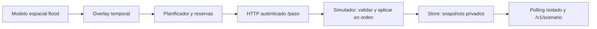

> **Referencia técnica histórica FASE 4A.** Para ejecutar el producto actual usar [desarrollo local](development/local-setup.md), [contratos](contratos.md) y [arquitectura](arquitectura.md). Hidrología, controles públicos y visores posteriores sustituyen las reglas/pantallas previas descritas aquí; los motores y reportes históricos se preservan.

# Inundaciones urbanas experimentales — FASE 4A

> Documento histórico. [FASE 8](informe-fase8.md) sustituyó el motor radial por
> hidrología conservativa; sus índices y parámetros radiales no describen el runtime actual.

Los escenarios de inundación emplean parámetros sintéticos y no constituyen pronósticos hidrológicos ni recomendaciones oficiales de evacuación.

## Ejecución local

Desde la raíz del repositorio, con Node y Go instalados:

```sh
# Tormenta con tres focos reproducibles y el grafo predeterminado de 300 nodos.
npm run simulate:flood -- -output reports/phase4a/storm.json -final-output reports/phase4a/final.json

# Foco elegido para provocar desvíos durante la evacuación, sin eventos externos.
npm run simulate -- -scenario scenarios/flood/urban-storm-stress.json -output reports/phase4a/stress.json

# API local que conserva el estado final hasta Ctrl+C.
npm run dev:flood -- -scenario scenarios/flood/urban-storm-stress.json -listen 127.0.0.1:8081 -interval 1s
```

En otra terminal:

```sh
curl http://127.0.0.1:8081/v1/scenario
curl http://127.0.0.1:8081/estado
curl http://127.0.0.1:8081/grafo
```

Para el maestro urbano, añadir `-graph data/manta-master.json` a cualquiera de los comandos Go anteriores mediante `npm run ... --`. El wrapper ejecuta Go desde `services/evacuation`, por eso las rutas de parámetros son relativas a ese directorio. Los resultados quedan allí, bajo `reports/`, ignorado por Git. El maestro tiene 9.179 nodos y 13.452 aristas; es la red urbana representada por la fuente conservada. `manta-expanded.json` tiene 1.000 nodos/1.599 aristas y es un preset intermedio, no toda Manta. El operativo conserva 300 nodos/383 aristas.

`cmd/server` y su catálogo de competición mantienen las tres rondas zombie y sus valores predeterminados. La API experimental usa `cmd/flood-server` en un puerto independiente. `API_KEY` es opcional en ese comando: en su ausencia genera una credencial efímera para sus propias decisiones HTTP; no la imprime. React sólo necesita las lecturas públicas. El comando admite `-origin` para los orígenes CORS y `-interval 0` para acelerar. Reiniciar el comando inicia otra reproducción; no añade administración ni un despliegue AWS.

## Auditoría y frontera de escenarios

El backend real utiliza biblioteca estándar Go, `world.Store` con copias privadas, un simulador como único escritor, pool de decisiones HTTP autenticadas, Dijkstra inverso por refugio, caché de planes inmutables, predicción de runners y reservas globales con histéresis. Las respuestas concurrentes se aplican por orden estable de agentes. Dormant sleepers y PRNG permanecen privados. El motor histórico `internal/evaluation/phase1`, las semillas, fixtures y fuentes geográficas anteriores se conservan.

`simulation.Config.scenario_type` ausente o `zombie` selecciona la evolución existente. `urban_flood` instala un adaptador `threatScenario` que suministra amenaza, cierres y reglas de espera/admisión. El núcleo conserva movimiento, reloj, snapshots, capacidad, reservas, validación de pasos y transporte. Una configuración de inundación rechaza zombies para evitar mezclar reglas accidentalmente. Otros nombres se rechazan explícitamente; terremotos y tsunamis podrán implementar esta misma frontera sin fingir que ya existen.



La inundación nunca mueve una horda ni se propaga por vecinos del grafo. Su PRNG independiente elige centros entre nodos ordenados y factores sintéticos, sin consumir la secuencia de aparición de agentes. Las zonas explícitas son útiles para estrés controlado; no se interpretan como riesgo geográfico observado. `urban-storm-stress.json` coloca un foco sobre un nodo frecuente de rutas iniciales para comprobar desvíos.

## Modelo y parámetros

Cada foco mantiene una acumulación normalizada `q`, acotada a `[0,1]`. Con entrada constante durante un tramo:

```text
input = flood_growth_rate × rainfall_intensity × profile(t) × seeded_factor
dq/dt = input − drainage_factor × q

decay = exp(−drainage_factor × dt)
q_next = clamp(q × decay + input/drainage_factor × (1−decay), 0, 1)
```

Si el drenaje es cero se utiliza `clamp(q + input×dt, 0, 1)`. La implementación usa `expm1` para evitar pérdida numérica e integra separadamente los tramos que cruzan fronteras del perfil. Cada tramo se acota a `[0,1]`; esta simplificación tampoco es conservación física de agua. La lluvia publicada es la intensidad media normalizada del último paso, cero antes de avanzar.

```text
radius = radius_min + (radius_max − radius_min) × q
exposure(distance) = q × max(0, 1 − (distance/radius)²)
road_risk = max(exposure de cada foco sobre la polilínea)
```

Las distancias usan una proyección local aproximada. Se calcula una sola vez la distancia mínima entre el centro y **cada segmento** de la geometría OSM, con extremos como alternativa cuando no hay polilínea. Esto detecta calles que cruzan un foco aunque sus extremos queden fuera. Cada paso actualiza únicamente la unión de aristas dentro de los radios máximos preindexados. El overlay no reconstruye ni modifica el grafo fuente.

| Campo dentro de `flood` | Predeterminado | Significado sintético |
| --- | --- | --- |
| `rainfall_profile` | `storm` | Llueve hasta 55% del tiempo; después drena |
| `rainfall_intensity` | 0,8 | Entrada normalizada, no mm/h |
| `simulation_duration` | 150 | Unidades del reloj simulado |
| `time_step` | 1 | Unidades por movimiento; no segundos físicos validados |
| `flood_growth_rate` | 0,08 | Tasa de crecimiento sintética |
| `drainage_factor` | 0,025 | Decaimiento proporcional a acumulación |
| `road_risk_thresholds.caution` | 0,30 | Entrada a precaución |
| `road_risk_thresholds.blocked` | 0,65 | Entrada a bloqueo |
| `road_risk_thresholds.hysteresis` | 0,08 | Banda de salida de estados |
| `road_risk_thresholds.caution_penalty` | 2 | Multiplica costo por `1+2=3` en precaución |
| `shelter_exposure_threshold` | 0,55 | Exclusión temporal de nuevos destinos |
| `evacuation_behavior` | `preventive` | Política de inicio de evacuación |
| `zones` | Tres centros según semilla | Radios sintéticos de 150 a 800 m |

`constant` mantiene entrada durante toda la duración; `pulse` llueve entre 15% y 45%. Los radios son distancias geométricas de un foco artificial; **no** son profundidad, extensión de una inundación observada ni perímetros certificados. La intensidad y el riesgo tampoco son probabilidades. Los focos generados aplican factores entre 0,85 y 1,15; los explícitos usan factor 1.

`seed` vive en la configuración general. Sin `turns`, la duración produce `ceil(simulation_duration/time_step)` pasos; el último tramo se recorta. Un `turns` explícito menor permite una reproducción truncada y no representa la duración completa. No se permite exceder la duración ni continuar un escenario de inundación terminado. Límites: 200 agentes, concurrencia 1–200, 10.000 pasos, 32 centros únicos y radios hasta 10 km. Se validan números finitos y umbrales ordenados. El JSON conserva ceros explícitos en lluvia, crecimiento, drenaje, histéresis y penalización; los parámetros omitidos toman los valores anteriores. El código Go programático debe partir de `flood.DefaultConfig()` si quiere todos los defaults numéricos.

## Calles, capacidad y comportamiento

Los estados son `passable`, `caution` y `blocked`. El bloqueo entra con riesgo ≥0,65 y sale por debajo de 0,57; precaución entra con riesgo ≥0,30 y sale por debajo de 0,22. Un salto grande puede bloquear directamente o recuperar a `passable`. La exposición de refugios también tiene banda de salida: `max(threshold/2, threshold−hysteresis)`.

Los bloqueos del grafo original, eventos explícitos e inundación se combinan con OR. Reabrir una calle desde un origen no elimina otro cierre vigente. Las condiciones exponen origen, riesgo normalizado, multiplicador de costo y último paso de actualización. Una calle bloqueada queda fuera del routing y de la validación autoritativa. Precaución multiplica el costo existente por un valor constante según estado; variar sólo riesgo descriptivo o timestamps no invalida Dijkstra. Cambiar costos efectivos, cierres o disponibilidad de refugios sí invalida sus búsquedas compartidas. Se conservan las histéresis de ruta/destino y las reservas existentes.

Los refugios pueden estar `available`, `full`, `exposed` o `inaccessible`. El acceso local requiere al menos una arista entrante transitable; no afirma acceso desde todos los orígenes. Exposición y acceso se filtran al planificar, validar reservas y admitir. Capacidad y ocupación no se alteran por exposición. Las reservas se liberan o reasignan, manteniendo `occupancy + reserved + available = capacity`; un refugio con todas sus plazas reservadas aún puede tener `state: available`, pero su `available` en `/estado` será cero. Los ocupantes ya evacuados permanecen evacuados aunque luego se exponga su refugio; se publica la condición, sin simular una segunda evacuación ni fallecimientos.

Las políticas se activan una vez por agente y no retroceden a espera:

- `preventive`: empieza desde el primer paso y puede planificar en el estado inicial.
- `late`: empieza con exposición local ≥0,35 o al llegar a 55% de la duración.
- `adaptive`: empieza con exposición local ≥0,15, lluvia media del paso ≥0,5 o 20% de la duración.

El simulador aplica la espera incluso si un cliente devuelve un movimiento anticipado. Un agente sin destino admisible queda `isolated`, vivo y recuperable. Esta categoría incluye falta de capacidad o de refugios admisibles, aunque haya una ruta física. `waiting` es espera deliberada por la política; `moving` tiene un plan de evacuación; `evacuated` ya llegó. El contrato histórico conserva `Survivor.status=active|bitten|evacuated`; en inundación `active` incluye las tres situaciones aún no evacuadas. No se reutiliza `bitten` ni `zombified` como resultado de inundación.

## Contratos para React — FASE 4B

La fuente de verdad es `packages/contracts/openapi.yaml`. Los tipos se generan en `packages/contracts/generated/api.d.ts` y los JSON Schemas en `schemas.json`. `/paso` mantiene nombres españoles, autenticación y respuesta exacta `siguienteNodo`; `/healthz` y `/grafo` conservan sus contratos. `/estado` añade únicamente `scenario_type` opcional para inundación y conserva el payload zombie anterior. No se agrega WebSocket.

React debe obtener `/grafo` una vez y asociarlo por `graph_version`, y hacer polling de `/v1/scenario` para el detalle. No debe combinar pasos o versiones de mundo diferentes al cruzar datos con `/estado`. Las lecturas pueden observar la planificación antes del movimiento o el resultado final de un paso; `world_version` distingue esas publicaciones. El endpoint devuelve 404 con el sobre de error común si la ronda es zombie. Los identificadores de ejecución del controlador de competición no se añaden artificialmente al servidor experimental; al reiniciarlo el consumidor debe descartar su estado local.

| Campo de `ScenarioSnapshot` | Uso de React |
| --- | --- |
| `scenario_type`, `simulation_step`, `world_version`, `graph_version` | Identificación y coherencia de lecturas |
| `simulation_time`, `simulation_duration`, `time_step`, `rainfall` | Reloj y entrada artificial |
| `flood_zones` | Círculos de exposición; `center`, `radius_m`, `intensity` |
| `road_conditions` | Overlay por `edge_id`, `state`, `risk_score`, `risk_source`, `cost_multiplier`, `updated_at_simulation_step` |
| `shelter_conditions` | Overlay por `shelter_id`; unir con capacidad/reservas de `/estado` |
| `agents` | Nodo, estado específico, comportamiento, refugio, ruta y tiempo de evacuación |
| `evacuation_metrics` | Resultados deterministas de la simulación |
| `performance` | Duraciones medidas del proceso; no confundir con tiempo simulado |
| `data_provenance` | Fuente del grafo, nombre del modelo, ausencia de elevación y texto obligatorio |

El detalle vial es una lista completa del **overlay candidato**, no del grafo entero ni de deltas desde la consulta anterior: calles ausentes conservan su condición base; candidatas recuperadas permanecen como `passable`. Los eventos explícitos también se incluyen, incluso después de reabrir. React debe reemplazar el overlay recibido en cada respuesta, no acumularlo. Las polilíneas se leen del grafo sin duplicarlas en cada polling. `evacuation_time`, cuando aparece, usa unidades simuladas desde el inicio, incluida espera; no duración de viaje física.

`evacuation_metrics` contiene total/evacuados/aislados/en espera, tiempo medio de evacuación, calles bloqueadas/precaución, refugios ocupados a capacidad, replanificaciones y duración simulada transcurrida. `reroute_count` cuenta cambios de un plan previamente no trivial durante preparación; no cuenta el mero recorte por avanzar ni cambios de caché. Los contadores de calles son del estado actual, no máximos históricos. `performance.simulation_step_latency_ms` y su acumulado miden trabajo del turno hasta antes de la última publicación; el benchmark registra además el `Step` completo y el tiempo de la ronda. No representan métricas AWS ni SLA.

## Fuentes, límites y adaptadores futuros

La geografía y sus checksums/procedencia permanecen en `services/evacuation/data/manta*.provenance.json`, los datos OSM comprimidos y la documentación de [grafo FASE 2](grafo-fase2.md). © OpenStreetMap contributors, ODbL-1.0. Los polígonos municipales sólo son orígenes de aparición; los refugios son ficticios sobre nodos reales. No se agregaron datos externos ni altitudes inventadas.

`flood.ElevationProvider` define una futura observación `(metres, available, provenance)`; no está conectado al cálculo actual y la procedencia publica `elevation_source: unavailable`. Una integración futura necesita datos verificables, resolución, datum, licencia, fecha y tratamiento de ausencia. Altura sola no demuestra seguridad de acceso, estabilidad del terreno ni protección ante otras amenazas.

No hay fluidodinámica, balance de cuenca, DEM, alcantarillado real, suelo, mareas, calibración, validación hidrológica ni ingestión de alertas. No se calcula mortalidad por inundación ni evacuación secundaria. Un paso mueve una arista independientemente de longitud física, conservando la regla del núcleo. El overlay tiene almacenamiento acotado por aristas y centros; el núcleo conserva historiales diagnósticos/latencias de duración acotada y continúa clonando el grafo en cada lectura, costo preexistente significativo en el maestro. Las mediciones y límites reales están en [informe FASE 4A](informe-fase4a.md).

Futuros adaptadores de lluvia observada, cierres externos o elevación deben registrar procedencia y tiempo de simulación, ser reproducibles desde entradas congeladas y conservar la autoridad del simulador. No se implementan proveedores meteorológicos ni nuevas infraestructuras en esta fase.

## Verificación reproducible

```sh
npm run test:backend
npm run test:race
npm run test:contracts:http
npm run test:contracts:flood
npm run bench:backend -- -requests 10000 -concurrency 16 -output reports/phase4a/zombie-http.json
npm run bench:flood -- -scenario scenarios/flood/urban-storm-stress.json -output reports/phase4a/flood-300.json
npm run bench:flood -- -graph data/manta-master.json -output reports/phase4a/flood-master.json
```

`flood-bench` mide en proceso aislado, revisa conservación/capacidad en cada paso, toma heap después de GC en tres puntos y calcula hashes de estado y trayectoria excluyendo únicamente mediciones de rendimiento. Para comprobar una reproducción completa usar `-expect-hash` con `deterministic_timeline_sha256` de la ejecución anterior. La duración y el consumo real varían; misma semilla no implica los mismos tiempos medidos.
